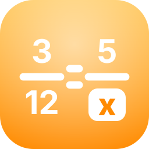

# Regla de 3

**Español.** Calcula lo que no sabes a partir de lo que sí sabes. Regla de tres **directa**, **inversa** y **compuesta**, **porcentajes**, aumentos, descuentos e **IVA (19 %)**, explicado **paso a paso con palabras simples**. No necesitas saber matemática: escribes lo que sabes, ves la respuesta al instante y puedes leer cómo se calculó.

**English.** Work out what you don't know from what you do. **Direct**, **inverse** and **compound** rule of three, **percentages**, increases, discounts and **VAT (19 %)**, explained **step by step in plain words**. You don't need to know math: type what you know, see the answer instantly and read how it was calculated.

| | |
|---|---|
| ✔ Más y más · Más y menos · Varias cosas · Porcentajes | Direct · Inverse · Compound · Percentages |
| ✔ Resultados **exactos** (fracciones, sin errores de redondeo) | Exact results, no floating-point errors |
| ✔ Números a la chilena (`1.234,56`, `12,5`, `3/4`) | Chilean number format |
| ✔ Modo claro y oscuro · se adapta a móvil, tableta y escritorio | Light & dark · phone, tablet, desktop |
| ✔ Sin internet · sin cuentas · sin publicidad | Offline · no accounts · no ads |

## Plataformas / Platforms
Linux (RPM, DEB, AppImage, Flatpak, Snap) · Windows 10/11 (instalador) · Android 4.0+ · macOS e iOS/iPadOS (proyecto XcodeGen) ·
**Sistemas antiguos** (núcleo en C89 con Open Watcom, en `nucleo/`): MS-DOS, Windows 3.x, Windows 95/98/Me, NT 3.5/3.51/4.0, 2000, XP, Vista, 7 y 8, y OS/2 Warp (`REGLA3-*.EXE` en las *releases*). **Móviles antiguos**: Symbian y teléfonos Java ME (`symbian/`, núcleo en Java en `java/`) y Android 1.6 en adelante con interfaz nativa (`android-antiguo/`). **Otras**: Tizen (`.wgt`) y webOS (`.ipk`) con la web antigua compatible con navegadores viejos (`web-antigua/`) y Commodore 64 (`c64/`, programa `.prg` hecho con cc65, aritmética entera de 64 bits).
Las descargas están en las *releases*. Downloads are in the releases.

## Desarrollo / Development
- Interfaz compartida en `ui/` (HTML + CSS + JavaScript sin dependencias); motor matemático en `ui/js/regla3.js`.
- Pruebas: `tests/ejecutar.sh` (Node.js). Linux: `make -C desktop` (GTK 4 + WebKitGTK 6). Windows: `herramientas/winhost/construir.sh windows`. Android: `cd android && ./gradlew assembleRelease`. Apple: `apple/LEEME.txt`.
- Empaquetado desde el código fuente para Arch, Fedora/openSUSE y Debian/Ubuntu: `packaging/`.

## Licencia y autoría / License & credits
GPL-3.0-or-later. Desarrollada por **Javiera Navarrete**. Hecha con asistencia de IA generativa: ver [AI-USO.md](AI-USO.md). Privacidad: [PRIVACY.md](PRIVACY.md).
